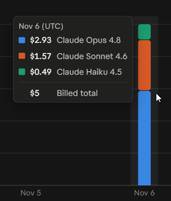

# Land or Water?

Ask a Claude model "Land or Water?" for one latitude/longitude at a time, typed as text, at
every 2° of the globe (16,200 points). Plot the answers. What comes out is the world map the
model learned from text alone.

No images, no tools, no system prompt, and thinking off wherever the model allows it. Each question
is a separate request:

```
Is the point at latitude 41, longitude -73 on land or in water?
Answer with exactly one word: Land or Water.
```

## Setup

```bash
uv sync                                   # or: pip install -e .
```

Paste your API key into the `.env` file in the project root (it is git-ignored):

```
ANTHROPIC_API_KEY=sk-ant-...
```

An `ANTHROPIC_API_KEY` environment variable also works and takes priority over `.env`.

## Usage

```bash
uv run landwater models                       # list models and presets; [default] marks the defaults
uv run landwater run --step 10 --live         # quick smoke test: 648 points x 3 models, ~$0.40
uv run landwater run --dry-run                # plan + cost estimate for the full 16,200-point grid
uv run landwater run                          # full run via the Batch API (asks before spending)
uv run landwater report                       # accuracy table + actual spend
uv run landwater plot --truth                 # plots/earth_step2.png, ground truth as the last map
uv run landwater plot --diff                  # error maps: orange = said land, blue = said water
```

- `--step` sets the grid spacing (must divide 180). `2` gives 16,200 points, `1` gives 64,800, `10` gives 648.
- `run` defaults to the **Message Batches API**: half price, usually done within an hour
  (up to 24h). `--no-wait` submits and exits; run the same command again later to collect.
- `--live` sends requests directly (full price, `--concurrency 16`). Good for small grids.
- Everything is resumable. Answers go to `results/<model>/step<N>.jsonl` as they arrive.
  Ctrl+C, then run the same command again: only unanswered points are asked.
- `plot` and `report` include every model that has results, unless you pass `-m`. The plot puts
  2 maps per row up to 4 maps (2×2), else 3 per row; `--cols N` overrides.

## Choosing models

Default: **Haiku 4.5, Sonnet 4.6, Opus 4.8**, all with thinking off. These are the three behind the
cost numbers below.

| Model | Key | Thinking |
|---|---|---|
| Sonnet 4.5 (retires 2026-11-30) | `sonnet-4.5` | off by default |
| Haiku 4.5 | `haiku-4.5` | off by default |
| Opus 4.5, 4.6, 4.7, 4.8 | `opus-4.5` ... `opus-4.8` | off by default |
| Sonnet 4.6 | `sonnet-4.6` | off by default |
| Sonnet 5, Opus 5, Haiku 5.5 | `sonnet-5`, `opus-5`, `haiku-5.5` | off: `thinking: {type: "disabled"}` |
| Sonnet 5.5 | `sonnet-5.5` | off: `thinking: {type: "between_tools"}` (no tools are sent, so it never thinks) |
| Fable 5, Fable 5.1, Opus 5.5 | `fable-5`, `fable-5.1`, `opus-5.5` | **always on**, can't be turned off; run at `effort: "low"`, starred `*` on the plot |

Presets:

| Preset | Models |
|---|---|
| `default` | the three defaults above |
| `figure` | the 12-model lineup of "How 12 blind Claudes see the Earth": Sonnet 4.5, Haiku 4.5, Opus 4.5, Opus 4.6, Sonnet 4.6, Opus 4.7, Opus 4.8, Fable 5, Sonnet 5, Opus 5, Fable 5.1, Opus 5.5 |
| `no-thinking` | every model that can run with thinking off |
| `thinking` | Fable 5, Fable 5.1, Opus 5.5 |
| `all` | everything |

### Pick models for one run

Pass model keys and/or presets to `-m` (same for `report` and `plot`):

```bash
uv run landwater run -m opus-5 sonnet-5.5             # two specific models
uv run landwater run -m default haiku-5.5             # defaults plus one more
uv run landwater run -m figure --dry-run              # check the cost before a big run
uv run landwater plot -m figure --truth               # plot just that lineup
```

Models that already have answers are skipped, so adding models later costs only the new ones.

### Change the defaults

Edit `DEFAULT_MODELS` in [landwater/models.py](landwater/models.py):

```python
DEFAULT_MODELS = ["haiku-4.5", "sonnet-4.6", "opus-4.8"]
```

Add your own preset to `PRESETS` in the same file to name a group you reuse.

### Experiment with variants

Each entry in `_ALL` in [landwater/models.py](landwater/models.py) is one model setup. Add a line
with a new key to try a different setting; results are stored per key, so variants never overwrite
each other. For example, Opus 5.5 with more thinking (there is a commented-out copy in the file):

```python
ModelSpec("opus-5.5-high", "claude-opus-5-5", "Opus 5.5 high", 4, 20,
          {"output_config": {"effort": "high"}}, thinks=True),
```

Then run `uv run landwater run -m opus-5.5 opus-5.5-high --step 10 --live` and compare with
`report`. The fields are: key, model ID, plot label, $ per 1M input tokens, $ per 1M output tokens,
extra request params, and `thinks=True` if the model thinks. Other things to try: a finer grid
(`--step 1`), or changing the prompt (`PROMPT` in [landwater/core.py](landwater/core.py)). If you change
the prompt, use a separate `--results` folder so old and new answers don't mix.

### Thinking checks

The first request for each model is a live probe. If a model that should have thinking off returns
a thinking block, that model is skipped. Every saved answer records `"thought": true/false`, and
`report` shows the count in the `thought` column: 0 for thinking-off models, and the full count for
Fable 5, Fable 5.1 and Opus 5.5.

**Cost warning for thinking models:** they write hidden thinking tokens on every answer and cost far
more than one-word answers. For the full grid, `run -m figure --dry-run` estimates about $270
(roughly $107 each for Fable 5 and 5.1, $43 for Opus 5.5) at a guessed 250 thinking tokens per
answer. Measure first with a tiny grid, then check `report` for real token counts:

```bash
uv run landwater run -m thinking --step 30 --live     # 72 points per model, about $2
uv run landwater report --step 30
```

## Other choices

- **Sampling**: default temperature for every model (the current API version doesn't allow
  changing it). Each point is asked once, so maps include sampling noise.
- **Refusal fallbacks are off on purpose.** A fallback answers with a different model, which
  would contaminate that model's map. Refusals are recorded and shown as gray "no clear answer" cells.
- **Probe request**: before a model's batch is submitted, one live request checks that the model
  ID and params are valid, so a bad config fails once, not 16,200 times.
- **Parsing**: raw reply text is stored; `land`/`water` is parsed when reports and plots are made, so
  the parser can change without re-asking. Replies naming neither or both words count as unclear.

## Scoring

Ground truth is [`global-land-mask`](https://pypi.org/project/global-land-mask/) (1-km grid from
GEBCO), sampled at each exact grid point. Accuracy is **area-weighted** by cos(latitude), since a
2° cell near the pole covers much less of the Earth than one at the equator. Unclear answers and
refusals count as wrong. `report` also shows unweighted accuracy, land/water recall and actual cost
from logged token usage.

## Cost

Actual API bill for this project with the three default models (Haiku 4.5, Sonnet 4.6, Opus 4.8),
thinking off: **$5 in total**.



That covers two runs: a `--step 10 --live` smoke test, then the full 2° grid through the Batch API.
Per-run split, from the token usage `landwater report` logs:

| Model | Full grid (16,200 points, batch) | Smoke test (648 points, live) | Billed |
|---|---|---|---|
| Opus 4.8 | $2.72 | $0.22 | $2.93 |
| Sonnet 4.6 | $1.46 | $0.12 | $1.57 |
| Haiku 4.5 | $0.46 | $0.04 | $0.49 |
| **Total** | **$4.64** | **$0.38** | **$5** |

Tokens used, summed from the per-answer usage logged in `results/` (that folder is git-ignored):

| Model | Run | Answers | Input tokens | Output tokens |
|---|---|---|---|---|
| Haiku 4.5 | full grid (2°, batch) | 16,200 | 583,200 | 66,113 |
| Sonnet 4.6 | full grid (2°, batch) | 16,200 | 583,200 | 77,939 |
| Opus 4.8 | full grid (2°, batch) | 16,200 | 745,200 | 68,508 |
| Haiku 4.5 | smoke test (10°, live) | 648 | 23,328 | 2,633 |
| Sonnet 4.6 | smoke test (10°, live) | 648 | 23,328 | 3,029 |
| Opus 4.8 | smoke test (10°, live) | 648 | 29,808 | 2,652 |
| **Total** | | **50,544** | **1,988,064** | **220,874** |

About **2.2 million tokens** in total. Each answer is 36 input tokens (46 on Opus 4.8, whose
tokenizer splits the same prompt into more tokens) and 4-5 output tokens. `run` prints an estimate
and asks before spending; `uv run landwater run --dry-run` shows the estimate only.

## Layout

```
landwater/
  models.py   model registry, thinking settings, DEFAULT_MODELS, presets
  core.py     grid, prompt, answer parsing, ground truth, scoring (no network)
  runner.py   batch + live runners, probe, cost estimate
  store.py    JSONL results + batch bookkeeping
  plot.py     small-multiples figure, error view, per-model pixel maps
  cli.py      `landwater` command, .env loading
tests/        offline tests (uv run pytest)
```
